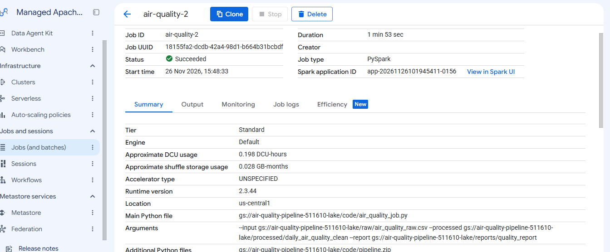
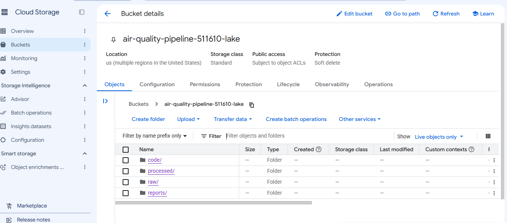
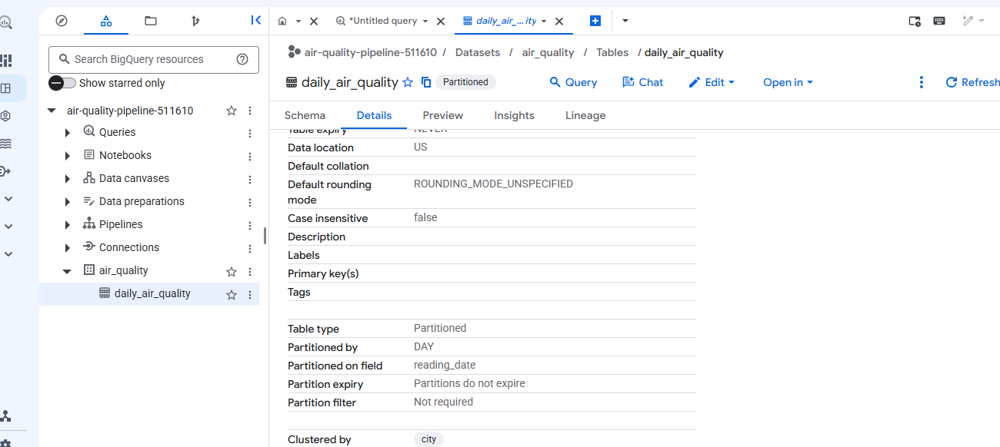

# GCP Air-Quality Batch Data Pipeline

A beginner-friendly **data engineering project that runs entirely on Google Cloud**. One **PySpark** job on **Dataproc Serverless** reads a messy raw CSV of daily city air-quality readings from **Cloud Storage**, cleans and validates it, saves the clean data and a quality report back to Cloud Storage, and loads it into a **partitioned and clustered BigQuery table**.

Nothing runs on your own computer. You upload one Python file and a CSV in the Google Cloud console, click **Submit**, and Google runs the pipeline. There is no cluster, no Java, no Spark and no Python to install.

## What it does

```
Cloud Storage  raw/air_quality_raw.csv
      │
      │   ONE Dataproc Serverless job  (air_quality_job.py, PySpark)
      ▼
 [1] Extract ─── read the raw CSV
 [2] Transform ─ fix city names, drop invalid dates and duplicate city-days,
      │          null out negative values, drop rows with no measurements,
      │          derive missing AQI from PM2.5, add AQI bucket, year, month, season
 [3] Quality ─── stop the job if the cleaned data breaks a rule
 [4] Load ────── Cloud Storage  processed/  (clean CSV)  and  reports/  (quality report)
                 BigQuery table partitioned by reading_date, clustered by city
```

## Skills shown
PySpark ETL on Dataproc Serverless (DataFrames, window functions, lazy evaluation) · running a Spark batch job in Google Cloud · data cleaning and validation · data-quality gate · Google Cloud Storage as a data lake · loading BigQuery from Spark (partitioning, clustering, idempotent loads) · IAM roles for a service account · Git

## Project structure
```
├── air_quality_job.py           # the whole pipeline: one PySpark file
├── data/raw/air_quality_raw.csv # SYNTHETIC sample data with deliberate problems
├── docs/                        # GCP_SETUP.md (step by step), LEARNING_GUIDE.md
└── images/                      # screenshots
```
Inside `air_quality_job.py` the code is split into numbered parts: 0 tables and settings, 1 extract, 2 transform, 3 quality, 4 load, and `main()`.

## Run it (all in the Google Cloud console)

You need a Google Cloud project with billing turned on. A run costs very little, because the job lives for a few minutes and then Google removes it.

**1. One-time setup** (APIs, bucket, network, permissions, BigQuery dataset): follow [docs/GCP_SETUP.md](docs/GCP_SETUP.md).

**2. Upload two files** to your bucket in the console:
- `data/raw/air_quality_raw.csv` into a folder called `raw`
- `air_quality_job.py` into a folder called `code`

**3. Submit the job.** Go to Dataproc -> Jobs (and batches) -> Serverless Spark -> Submit job, and fill in:

| Box | Value |
|---|---|
| Job ID | `air-quality-1` (use a new ID for every run) |
| Job type | PySpark |
| Main Python file | `gs://YOUR_BUCKET/code/air_quality_job.py` |
| Arguments (one per box) | `--bucket`, `YOUR_BUCKET`, `--table`, `YOUR_PROJECT.air_quality.daily_air_quality` |

**4. Check the result.** The job turns **Succeeded** after a few minutes. Open the job's logs to read the data-quality report, then look at your bucket (`processed/`, `reports/`) and at the BigQuery table `air_quality.daily_air_quality`.

What the job does with your bucket: it reads `raw/air_quality_raw.csv`, writes the clean CSV to `processed/daily_air_quality_clean/` and the report to `reports/quality_report/`. It also uses the bucket for temporary files while it loads BigQuery, and deletes them afterwards.

If a data-quality check fails, the job stops with an error, nothing is written to `processed/` or BigQuery, and the report in `reports/` shows which check failed.

### Screenshots from my Google Cloud run

**Dataproc Serverless job** (PySpark, succeeded in 2 min 22 sec, about 0.24 DCU-hours):



**Cloud Storage bucket (data lake)** with the `raw/`, `code/`, `processed/` and `reports/` folders:



**BigQuery table**: partitioned by day on `reading_date` and clustered by `city`:



## About the data
`data/raw/air_quality_raw.csv` is **synthetic**, created for this project so it is self-contained. It mimics a public city-level air-quality layout (`City, Date, PM2.5, PM10, NO2, SO2, CO, O3, AQI, AQI_Bucket`) and includes deliberate problems: missing values, negative readings, duplicate rows, messy city names and invalid dates. To use real data, upload a file with the same columns instead. Dates must be `YYYY-MM-DD`. For this sample file the job reads 4,445 rows and keeps 4,272.

The AQI derivation from PM2.5 uses simplified breakpoints modelled on India's CPCB scale. It is for learning, not for official reporting.

## Design decisions
| Decision | Reason |
|---|---|
| Everything runs on Google Cloud | Nothing to install or run on your computer. Spark and Java are already inside Dataproc |
| Dataproc Serverless batch | No cluster to create, size or delete. Google starts Spark for the job, runs it and removes it, and you pay only while it runs |
| One PySpark file | One file to upload, with no zip or packaging step. The parts are numbered so it is easy to read |
| Files go through Cloud Storage | Google's Spark cannot see your computer. It reads `raw/` and writes `processed/` and `reports/` in the bucket, like a real data lake |
| The job loads BigQuery itself | Dataproc has the Spark BigQuery connector built in, so one job does the whole pipeline end to end |
| Read all columns as text, then cast | Spark does not guess types wrong, and every bad value is counted by a rule |
| Explicit column types | The last cleaning step casts each column to its final type, so BigQuery gets the schema we chose |
| Window function for duplicates | `row_number()` over (city, day) keeps the first row of each group, the Spark way to deduplicate |
| `cache()` on tables that are used again | Spark is lazy; caching stops it from repeating all the work for every count |
| One CSV file (`coalesce(1)`) | Easy to open and download. Fine for small data; for big data keep Spark's parallel part files or Parquet |
| Quality gate before anything is written | Bad data never reaches `processed/` or BigQuery. The report is still written, so you can see what failed |
| Overwrite on every run | Re-running gives the same result and never duplicates rows (idempotent) |
| Partition by date, cluster by city | Cheaper, faster queries that filter by date or city |
| Every cleaning rule counts its changes | The report shows exactly what was fixed |
| A service account with only the roles it needs | The job runs as the project's default Compute Engine service account with Dataproc Worker, Storage Object Admin on the bucket, and BigQuery Data Editor and Job User |

## Limitations and next steps
- Batch only. Add incremental loads (append new days, then `MERGE`).
- CSV output. Parquet (`df.write.parquet(...)` in Spark) would be smaller and keep types.
- The data is tiny. For big data, drop `coalesce(1)`, write Parquet and let Dataproc use more workers.
- You start each run by hand in the console. To schedule it, trigger the same batch with Cloud Scheduler and Workflows, or orchestrate with Cloud Composer (Airflow).
- The raw file is uploaded by hand. In a real setup, files would land in the bucket from other systems and the job would only read them.
- No automated tests. The job is checked by its own data-quality gate, the row counts in the report and the BigQuery table. Unit tests for the cleaning rules would need a local Spark.
- Add a dashboard (Looker Studio) on top of the BigQuery table.

## License
MIT
