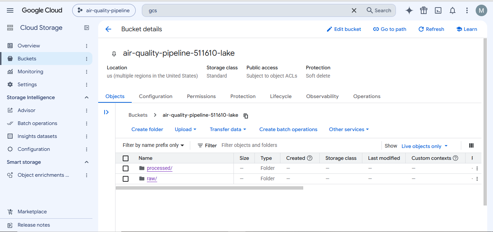
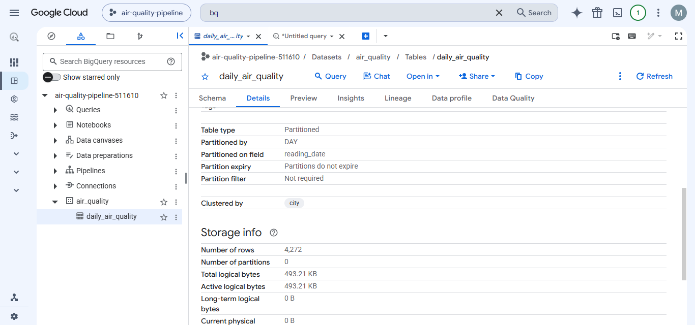
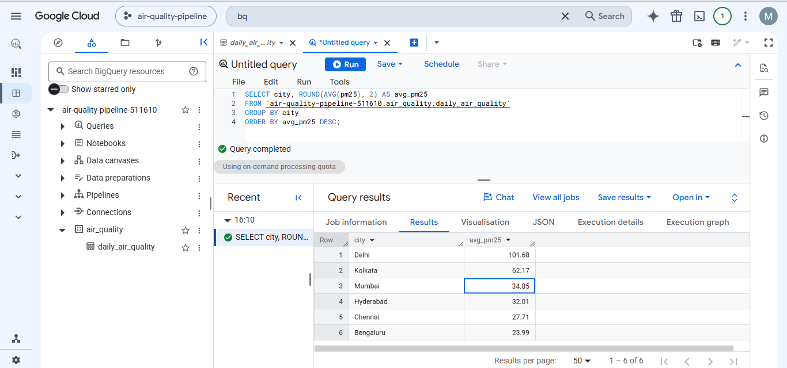

# GCP Air-Quality Batch Data Pipeline

A beginner-friendly **data engineering project on Google Cloud**. It takes a messy raw CSV of daily city air-quality readings, cleans and validates it with **Python (Pandas)**, stages it in **Cloud Storage**, and loads it into a **partitioned and clustered BigQuery table**.

It also runs fully **locally** (SQLite instead of BigQuery), so you can develop and test without a cloud account.

## What it does

```
data/raw/air_quality_raw.csv
        │
   [1] Extract ── read the raw file as text
        │
   [2] Transform ─ clean + enrich with Pandas
        │           • fix city names (Bangalore -> Bengaluru), trim spaces
        │           • drop invalid dates and duplicate city-days
        │           • null out impossible negative values
        │           • drop rows with no measurements
        │           • derive missing AQI from PM2.5, add AQI bucket, year, month, season
        │
   [3] Quality gate ─ stop the run if the cleaned data breaks a rule
        │
   [4] Load ──┬─ local mode: SQLite
              └─ gcp mode:   Cloud Storage (raw/ + processed/) ──> BigQuery
                              table partitioned by reading_date, clustered by city
```

## Skills shown
Python ETL with Pandas · data cleaning and validation · data-quality checks · Google Cloud Storage · BigQuery (partitioning, clustering, explicit schema, idempotent loads) · configuration through environment variables · unit tests · Git

## Project structure
```
├── run_pipeline.py              # entry point (--mode local | gcp)
├── src/pipeline/
│   ├── extract.py               # read raw CSV
│   ├── transform.py             # cleaning rules + quality counters
│   ├── quality.py               # data-quality gate
│   ├── load_gcp.py              # Cloud Storage upload + BigQuery load
│   ├── local_warehouse.py       # SQLite stand-in for BigQuery
│   ├── pipeline.py              # orchestrates the four steps
│   └── config.py                # settings from environment variables
├── scripts/generate_sample_data.py
├── data/raw/air_quality_raw.csv # SYNTHETIC sample data with deliberate problems
├── tests/                       # unit tests
└── docs/                        # GCP_SETUP.md, LEARNING_GUIDE.md
```

## Quick start (no cloud account needed)
```bash
git clone https://github.com/MohanNellore/gcp-air-quality-pipeline.git
cd gcp-air-quality-pipeline
python -m venv venv
venv\Scripts\activate            # Mac/Linux: source venv/bin/activate
pip install -r requirements.txt
python run_pipeline.py --mode local
python -m unittest discover -s tests -v
```
You will see a data-quality report. The clean CSV and `quality_report.json` are saved in `outputs/`.

## Run it on Google Cloud
Follow [docs/GCP_SETUP.md](docs/GCP_SETUP.md), then:
```bash
python run_pipeline.py --mode gcp
```
Open the BigQuery console to see the `air_quality.daily_air_quality` table, partitioned by `reading_date` and clustered by `city`.

### Screenshots from my Google Cloud run

**Cloud Storage bucket (data lake)** with the `raw/` and `processed/` folders:



**BigQuery table**: partitioned by day on `reading_date`, clustered by `city`, 4,272 rows:



**Query result**: average PM2.5 per city:



## About the data
`data/raw/air_quality_raw.csv` is **synthetic** (generated by `scripts/generate_sample_data.py`) so the project is self-contained. It mimics a public city-level air-quality layout (`City, Date, PM2.5, PM10, NO2, SO2, CO, O3, AQI, AQI_Bucket`) and includes deliberate problems: missing values, negative readings, duplicate rows, messy city names and invalid dates. To use real data, replace the CSV with a file that has the same columns. Dates must be `YYYY-MM-DD`.

The AQI derivation from PM2.5 uses simplified breakpoints modelled on India's CPCB scale. It is for learning, not for official reporting.

## Design decisions
| Decision | Reason |
|---|---|
| Explicit BigQuery schema | No surprises from schema auto-detection |
| `WRITE_TRUNCATE` load | Re-running gives the same result, never duplicates (idempotent) |
| Partition by date, cluster by city | Cheaper, faster queries that filter by date or city |
| Quality gate before loading | Bad data never reaches the warehouse |
| Every cleaning rule counts its changes | The report shows exactly what was fixed |
| SQLite local mode | Extract, transform and quality checks can be tested without cloud access |
| Credentials via `gcloud auth application-default login` | No keys stored in the repo |

## Limitations and next steps
- Batch only. Add incremental loads (append new days, then `MERGE`).
- CSV staging. Parquet would be smaller and keep types.
- Run on demand. Schedule with Cloud Scheduler plus Cloud Run, or orchestrate with Cloud Composer (Airflow).
- SQLite is only a stand-in for the BigQuery load step in local mode. Always confirm the real load in BigQuery.
- Add a dashboard (Looker Studio) on top of the BigQuery table.

## How I ran it in Google Cloud Shell

Everything below was run in Cloud Shell (the `>_` icon in the Google Cloud console). Cloud Shell already has Python, git and gcloud installed and is already logged in, so no key file is needed.

**1. Set the project**
```bash
gcloud config set project air-quality-pipeline-511610
gcloud auth application-default set-quota-project air-quality-pipeline-511610
```

**2. Enable the APIs**
```bash
gcloud services enable bigquery.googleapis.com storage.googleapis.com
```

**3. Create the Cloud Storage bucket (data lake)**
```bash
gcloud storage buckets create gs://air-quality-pipeline-511610-lake --location=US
```

**4. Get the code**
```bash
git clone https://github.com/MohanNellore/gcp-air-quality-pipeline.git
cd gcp-air-quality-pipeline
```

**5. Install the dependencies**
```bash
pip install -r requirements.txt
```

**6. Set the configuration**
```bash
export GCP_PROJECT_ID=air-quality-pipeline-511610
export BQ_DATASET=air_quality
export BQ_TABLE=daily_air_quality
export BQ_LOCATION=US
export GCS_BUCKET=air-quality-pipeline-511610-lake
```

**7. Run the pipeline**
```bash
python run_pipeline.py --mode gcp
```
This runs four steps: Extract, Transform, Quality checks, and Load (Cloud Storage and BigQuery).

**8. Check the result (optional)**
```bash
bq query --use_legacy_sql=false \
'SELECT city, ROUND(AVG(pm25), 2) AS avg_pm25
 FROM `air-quality-pipeline-511610.air_quality.daily_air_quality`
 GROUP BY city ORDER BY avg_pm25 DESC'
```

**9. Clean up so nothing is billed**
```bash
bq rm -r -f -d air-quality-pipeline-511610:air_quality
gcloud storage rm --recursive gs://air-quality-pipeline-511610-lake
```

## License
MIT

